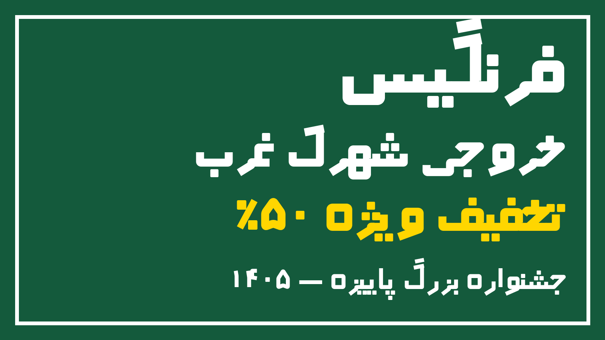
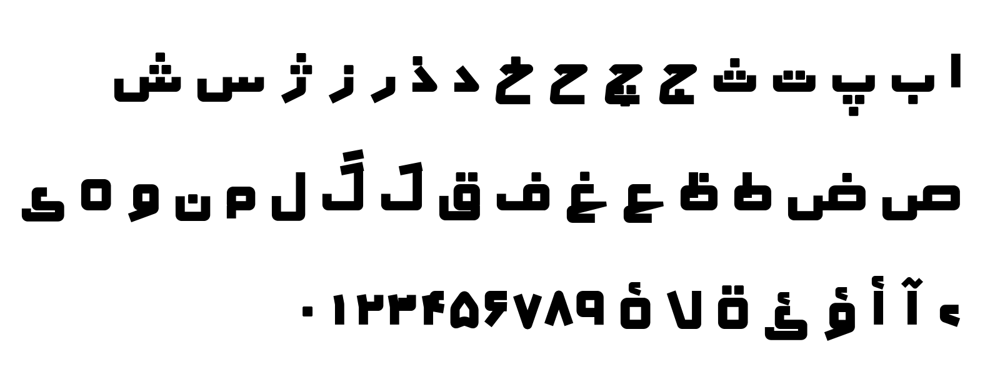
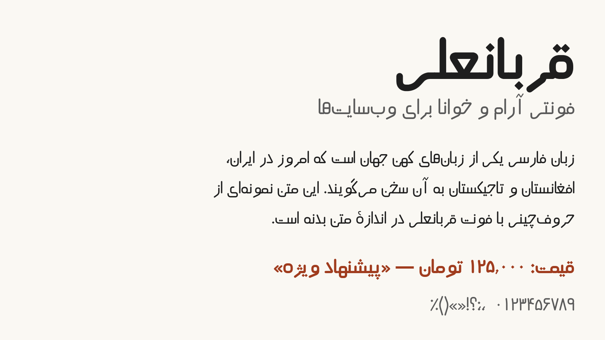
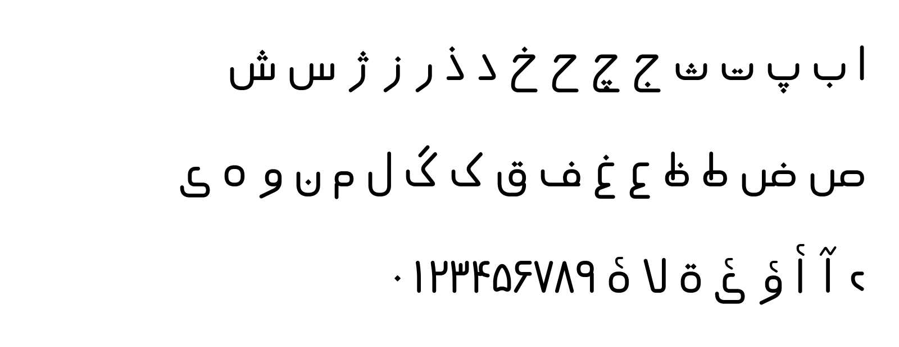

<div dir="rtl">

# فونت‌های فرنگیس و قربانعلی

دو فونت فارسی رایگان و متن‌باز از **علیرضا رحیمی**.

| فونت | کاربرد | وزن‌ها |
|---|---|---|
| **فرنگیس** (Farangis) | طراحی گرافیک: بنر، بیلبورد، پوستر، تابلوی بزرگراه، تیتر | ضخیم (Bold)، سیاه (Black) |
| **قربانعلی** (Ghorbanali) | متن وب‌سایت و رابط کاربری | معمولی (Regular)، ضخیم (Bold) |

## فرنگیس



فرنگیس فونتی هندسی و پرقدرت به سبک کوفی مدرن است. گوشه‌ها تیز، فضاهای داخلی باز و نقطه‌ها مربعی و درشت‌اند. این ویژگی‌ها حروف را از فاصلهٔ دور، روی بنر و تابلوی بزرگراه، خوانا نگه می‌دارند.



## قربانعلی



قربانعلی فونتی آرام و گرد با ضخامت یکنواخت است. دندانه‌ها و فضاهای داخلی بازند و نقطه‌ها لوزی‌شکل‌اند، تا متن در اندازه‌های کوچک صفحهٔ وب هم خوانا بماند. فایل‌ها هینت شده‌اند تا روی ویندوز هم واضح نمایش داده شوند.



## نصب

* **روی رایانه:** فایل‌های `.ttf` را از پوشهٔ `Farangis/fonts/ttf` یا `Ghorbanali/fonts/ttf` دانلود و نصب کنید. در فتوشاپ، ایلاستریتور، ورد و دیگر نرم‌افزارها با نام‌های Farangis و Ghorbanali در دسترس‌اند.
* **در وب‌سایت:** پوشهٔ فونت را کنار فایل‌های سایت قرار دهید و فایل CSS آن را اضافه کنید:

</div>

```html
<link rel="stylesheet" href="Ghorbanali/ghorbanali.css">
<style>
  body { font-family: "Ghorbanali", Tahoma, sans-serif; }
  h1   { font-family: "Farangis", "Ghorbanali", sans-serif; font-weight: 900; }
</style>
```

<div dir="rtl">

فونت‌ها فقط حروف فارسی را دارند. برای متن لاتین، مثل نمونهٔ بالا یک فونت جایگزین در `font-family` بگذارید.

## پوشش نویسه‌ها

* همهٔ ۳۲ حرف الفبای فارسی با شکل‌های آغازی، میانی، پایانی و تنها
* همزه و حروف همزه‌دار (ء آ أ إ ؤ ئ ۀ)، ة، و ي و ك عربی
* ترکیب «لا» به‌صورت لیگاتور
* ارقام فارسی (۰ تا ۹) با عرض یکسان، که برای ارقام عربی (٠ تا ٩) هم استفاده می‌شوند
* علائم: ، ؛ ؟ ! . : « » ( ) - – — ٪ ٫ ٬ + = /
* اعراب: فتحه، کسره، ضمه، تنوین‌ها، تشدید، سکون، الف مقصوره، همزهٔ بالا و پایین
* نیم‌فاصله (ZWNJ) و کشیده (ـ)

## ساخت از روی سورس

همهٔ حروف با کد و از روی اسکلت خطی تعریف شده‌اند. پوشهٔ `src` شامل این فایل‌هاست:

* `letters.py`: تعریف شکل حروف، ارقام و علائم
* `geom.py`: تبدیل اسکلت به حروف توپر
* `build.py`: تنظیم ضخامت و تناسب هر وزن، ساخت فایل‌های TTF، WOFF و WOFF2 به همراه قواعد اتصال حروف (OpenType)

</div>

```bash
pip install -r requirements.txt
python3 src/build.py .          # فایل‌ها را در Farangis/fonts و Ghorbanali/fonts می‌سازد
python3 src/specimens.py        # تصاویر نمونه را دوباره می‌سازد
```

<div dir="rtl">

## مجوز

این فونت‌ها تحت مجوز [SIL Open Font License 1.1](OFL.txt) منتشر شده‌اند. استفاده در پروژه‌های شخصی و تجاری، از جمله چاپ، وب، اپلیکیشن و ویدیو، آزاد و رایگان است. فروش خود فایل فونت مجاز نیست و نسخه‌های تغییریافته باید نام دیگری داشته باشند.

© ۲۰۲۶ علیرضا رحیمی

</div>

---

## English

**Free Persian (Farsi) fonts for display and web — by Alireza Rahimi.** Open source, free for personal and commercial use (SIL Open Font License 1.1).

| Font | Best for | Style | Weights | Files |
|---|---|---|---|---|
| **Farangis** | Banners, billboards, posters, highway & street signage, headlines, logos | Geometric Kufi display, sharp corners, square dots, high legibility at a distance | Bold (700), Black (900) | TTF, WOFF2, WOFF |
| **Ghorbanali** | Websites, apps, UI, body text | Rounded monoline sans, open counters, hinted for screens | Regular (400), Bold (700) | TTF, WOFF2, WOFF |

**Script coverage:** Persian / Farsi (fa-IR) alphabet with all contextual forms (isolated, initial, medial, final), lam-alef ligatures, Arabic-letter variants (ي ك ة ى), hamza forms, Persian digits ۰–۹ (also mapped to Arabic-Indic ٠–٩), Persian punctuation (، ؛ ؟ « » ٪ ٫ ٬), harakat/diacritics with mark positioning, ZWNJ (half-space) and tatweel. Shaping works through standard OpenType features (`init`, `medi`, `fina`, `rlig`, `mark`, `mkmk`) in HarfBuzz, browsers, Adobe apps, Microsoft Office and Figma. Latin letters are not included — pair with a Latin font via CSS fallback.

**Use on the web:**

```css
@import url("Ghorbanali/ghorbanali.css");
body { font-family: "Ghorbanali", system-ui, sans-serif; }
h1   { font-family: "Farangis", sans-serif; font-weight: 900; }
```

**Desktop:** install the `.ttf` files from `Farangis/fonts/ttf` and `Ghorbanali/fonts/ttf`.

**Source:** every glyph is defined as code (centre-line skeletons in `src/letters.py`), turned into outlines and built with fontTools — see *Build from source* above.

Keywords: Persian font, Farsi font, free Persian font, Persian web font, Farsi webfont, Persian display font, Persian Kufi font, billboard font, signage font, Iranian font, RTL font, Arabic-script font, فونت فارسی، فونت رایگان فارسی، فونت وب فارسی، فونت تیتر، فونت بنر، فونت کوفی.
